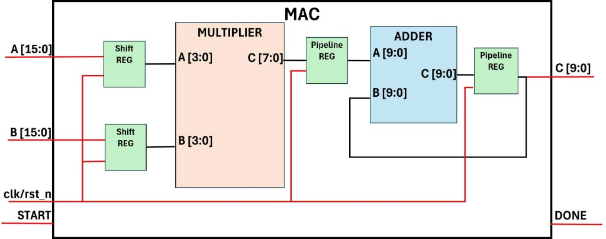
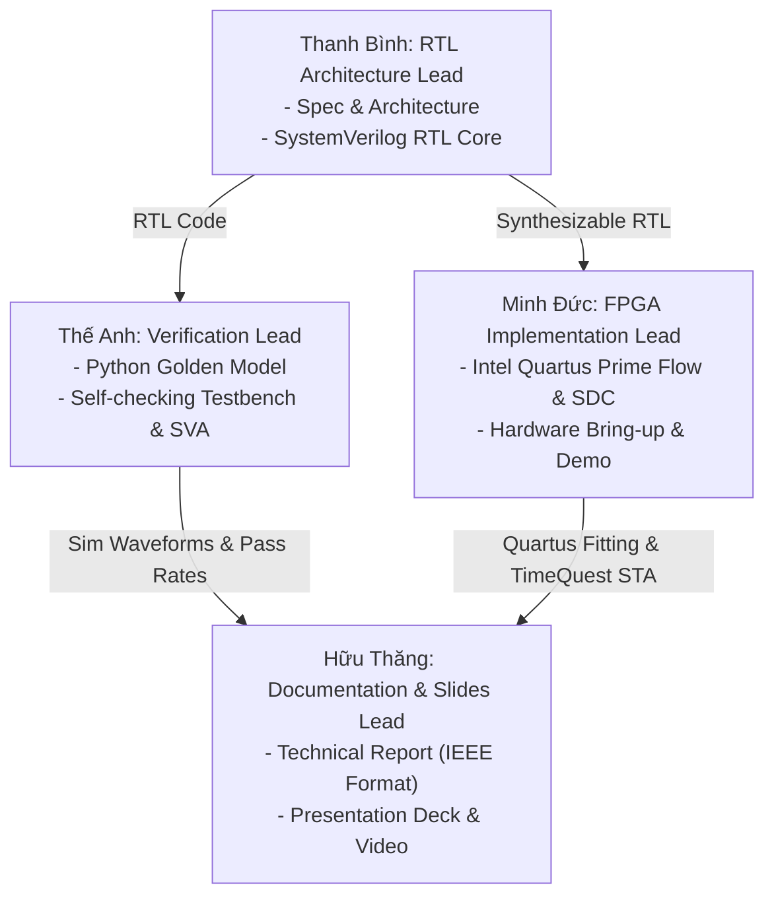

# EE5427: 4-element 4-bit Pipelined Multiply-Accumulate (MAC) Unit

[](https://en.wikipedia.org/wiki/SystemVerilog)
[](https://www.intel.com/content/www/us/en/software/programmable/quartus-prime/overview.html)
[](https://www.intel.com)
[](https://www.intel.com/content/www/us/en/products/details/fpga/max-10.html)
[](LICENSE)

---

## 1. Project Overview & Motivation

In high-performance digital computing—specifically across **Digital Signal Processing (DSP)**, **Deep Learning inference engines (Systolic Arrays, TPU cores)**, and **Matrix-Vector Multiplications (MVM)**—the **Multiply-Accumulate (MAC)** unit is the core arithmetic workhorse.

This repository hosts the full RTL design, verification, and Intel FPGA implementation for a **4-element 4-bit pipelined Multiply-Accumulate unit** developed for **EE5427**. Given two 16-bit input vectors $A$ and $B$, each packed with four unsigned 4-bit elements:

$$\mathbf{A} = \{A_3, A_2, A_1, A_0\}, \quad \mathbf{B} = \{B_3, B_2, B_1, B_0\}$$

The MAC unit sequentially processes the four element pairs and computes their scalar dot-product:

$$C = \sum_{i=0}^{3} A_i \times B_i = A_0 \cdot B_0 + A_1 \cdot B_1 + A_2 \cdot B_2 + A_3 \cdot B_3$$

---

## 2. Microarchitecture & Block Diagram

The datapath decouples the multiplication and accumulation stages using an intermediate pipeline register to maximize operating frequency ($F_{max}$) and prevent long combinational paths.



### Datapath Sub-modules

| Logic Block | Bitwidth / Type | Description & Functionality |
| :--- | :--- | :--- |
| **Input / Shift Registers** | 16-bit parallel load, 4-bit shift | Latches vectors $A[15:0]$ and $B[15:0]$ on `START = 1`. Sequentially shifts right by 4 bits each cycle to present pairs $(A_i, B_i)$ to the multiplier. |
| **Multiplier** | 4-bit $\times$ 4-bit $\to$ 8-bit combinational | Computes unsigned product $A_i \times B_i$. Maximum single product is $15 \times 15 = 225$. |
| **Product Pipeline Register** | 8-bit registered | Registers the multiplier output on the clock edge, establishing pipeline Stage 1 and breaking the critical path between multiplier and adder. |
| **Accumulator / Adder** | 10-bit adder ($10\text{b} + 10\text{b} \to 10\text{b}$) | Sums the zero-extended 8-bit registered product $\{2'b00, P_i\}$ with the accumulated sum feedback. |
| **Accumulator Pipeline Register** | 10-bit registered | Latches the accumulated sum, feeds back to Port B of the adder, and directly drives top-level output $C[9:0]$. Cleared to 0 at the start of calculation. |
| **Control Logic & Counter** | 3-bit sequencer FSM | Tracks the 4-phase calculation cycles, generates shift enables, controls accumulator clear/feedback, and asserts `DONE`. |
| **DONE Logic** | 1-bit status output | Asserted high when the accumulation of all 4 products has settled in the output register. |
| **Reset Logic** | Active-low asynchronous | Restores all datapath registers and FSM states to a clean initialized state. |

---

## 3. Mathematical Analysis & Bitwidth Proof

### 1. Element Range
Each element $A_i, B_i$ is an unsigned 4-bit integer:
$$0 \le A_i \le 2^4 - 1 = 15$$
$$0 \le B_i \le 2^4 - 1 = 15$$

### 2. Multiplier Bitwidth
The maximum product of a single element pair occurs when $A_i = 15$ and $B_i = 15$:
$$P_{max} = 15 \times 15 = 225$$
$$\lceil \log_2(225 + 1) \rceil = \lceil \log_2(226) \rceil = 8 \text{ bits}$$
Thus, an **8-bit bus** $P[7:0]$ ($[0, 255]$) provides sufficient range with zero overflow.

### 3. Accumulator Bitwidth
The maximum possible dot-product accumulated over 4 elements is:
$$C_{max} = \sum_{i=0}^3 P_{max} = 4 \times 225 = 900$$
To guarantee no overflow:
$$\lceil \log_2(900 + 1) \rceil = \lceil 9.815 \rceil = 10 \text{ bits}$$
With a **10-bit output bus** $C[9:0]$, the representable range is $[0, 1023]$, guaranteeing that **overflow is mathematically impossible** since $900 < 1023$.

---

## 4. Input / Output Interface Specifications

| Signal Name | Direction | Bitwidth | Active Level | Description |
| :--- | :---: | :---: | :---: | :--- |
| `clk` | Input | 1 bit | Rising Edge | System operating clock (50 MHz / 100 MHz). |
| `rst_n` | Input | 1 bit | Low (`0`) | Asynchronous active-low global reset. Returns registers and FSM to initial state. |
| `START` | Input | 1 bit | High (`1`) | 1-clock-cycle pulse requesting the MAC unit to latch $A$ and $B$ and trigger a new computation. |
| `A` | Input | 16 bit | - | Packed input vector $A = \{A_3, A_2, A_1, A_0\}$. Each chunk is unsigned 4-bit. |
| `B` | Input | 16 bit | - | Packed input vector $B = \{B_3, B_2, B_1, B_0\}$. Each chunk is unsigned 4-bit. |
| `C` | Output | 10 bit | - | Final dot-product result: $\sum_{i=0}^3 A_i \times B_i$. Valid when `DONE = 1`. |
| `DONE` | Output | 1 bit | High (`1`) | Flags that the calculation is complete and output $C[9:0]$ holds a valid result. |

---

## 5. Timing Diagram & Cycle-by-Cycle Execution Trace

| Clock Cycle | FSM State / Counter | Shift Reg A Output | Shift Reg B Output | Multiplier Product $P$ | Pipeline Reg ($P_{reg}$) | Adder Output | Accumulator Reg ($C$) | `DONE` |
| :---: | :---: | :---: | :---: | :---: | :---: | :---: | :---: | :---: |
| **0** | `START = 1` | $A_0$ | $B_0$ | $A_0 \cdot B_0$ | `0` | `0` | `0` | `0` |
| **1** | `CALC (count=1)` | $A_1$ | $B_1$ | $A_1 \cdot B_1$ | $P_0$ | $P_0 + 0$ | `0` | `0` |
| **2** | `CALC (count=2)` | $A_2$ | $B_2$ | $A_2 \cdot B_2$ | $P_1$ | $P_1 + P_0$ | $P_0$ | `0` |
| **3** | `CALC (count=3)` | $A_3$ | $B_3$ | $A_3 \cdot B_3$ | $P_2$ | $P_2 + (P_0 + P_1)$ | $P_0 + P_1$ | `0` |
| **4** | `CALC (count=4)` | - | - | - | $P_3$ | $P_3 + \sum_{0}^2 P_i$ | $\sum_{0}^2 P_i$ | `0` |
| **5** | `FINISH (count=5)`| - | - | - | - | - | **$\sum_{i=0}^3 P_i$** | **`1`** |

- **Latency:** 5 clock cycles from the assertion of `START` to the assertion of `DONE`.
- **Throughput:** A new operation can be accepted every 6 clock cycles.

---

## 6. Project Directory Structure

```text
EE5427---4x4-Multiply-Accumulate/
├── README.md                      # Project documentation and specifications
├── .gitignore                     # Git ignore rules for Intel Quartus Prime & EDA junk
├── docs/                          # Design documents and schematics
│   ├── mac_block_diagram.jpg      # Microarchitecture block diagram
│   └── mac_block_specification.pdf# Course specification document
├── rtl/                           # Synthesizable SystemVerilog source code
│   ├── mac_top.sv                 # Top-level MAC module & sequencer
│   ├── shift_reg.sv               # 16-bit to 4-bit serialization shift register
│   ├── multiplier_4x4.sv          # 4-bit x 4-bit unsigned combinational multiplier
│   └── adder_10bit.sv             # 10-bit accumulator adder
├── tb/                            # Verification environment
│   ├── mac_top_tb.sv              # Self-checking SystemVerilog testbench
│   └── mac_ref_model.py           # Python golden model & vector generator
└── fpga/                          # Intel Quartus Prime implementation files
    ├── constraints/
    │   ├── mac_de10_lite.sdc      # Synopsys Design Constraints (TimeQuest STA)
    │   └── mac_de10_lite.qsf      # Intel Quartus Settings File (Pin assignments)
    └── top_fpga_wrapper.sv        # Intel FPGA evaluation wrapper (Switches, LEDs, Keys)
```

---

## 7. Team Work Breakdown & Responsibilities (4 Members)

The project tasks are distributed across 4 team members: **Thanh Bình**, **Thế Anh**, **Minh Đức**, and **Hữu Thăng**:



### Assignment & Issues Matrix

| Member | Primary Role | Assigned Tasks / GitHub Issues | Key Deliverables |
| :--- | :--- | :--- | :--- |
| **Thanh Bình** | **RTL Architecture Lead** | • [Issue #3](https://github.com/ducnguyen-git/EE5427---4x4-Multiply-Accumulate/issues/3): Microarchitecture Spec & Interface Contract<br>• [Issue #2](https://github.com/ducnguyen-git/EE5427---4x4-Multiply-Accumulate/issues/2): SystemVerilog RTL Implementation (`mac_top`) | Architectural spec, mathematical sizing proof, synthesizable RTL (`mac_top.sv`, `shift_reg.sv`, `multiplier_4x4.sv`, `adder_10bit.sv`), clean linting. |
| **Thế Anh** | **Design Verification Lead** | • [Issue #4](https://github.com/ducnguyen-git/EE5427---4x4-Multiply-Accumulate/issues/4): Python Golden Model & Stimulus Suite<br>• [Issue #1](https://github.com/ducnguyen-git/EE5427---4x4-Multiply-Accumulate/issues/1): Self-Checking Testbench & Coverage Sign-off | Python reference model (`mac_ref_model.py`), corner-case vectors (`test_vectors.hex`), self-checking SystemVerilog testbench (`mac_top_tb.sv`), SVA assertions, waveform traces. |
| **Minh Đức** | **FPGA Implementation Lead** | • [Issue #5](https://github.com/ducnguyen-git/EE5427---4x4-Multiply-Accumulate/issues/5): Intel Quartus Prime Synthesis, Constraints (.sdc) & STA<br>• [Issue #6](https://github.com/ducnguyen-git/EE5427---4x4-Multiply-Accumulate/issues/6): Board Bring-Up, SOF Programming & Hardware Demo | Quartus Prime project, TimeQuest SDC constraints (`mac_de10_lite.sdc`), TimeQuest STA closure, FPGA board wrapper (`top_fpga_wrapper.sv`), SOF file, hardware demo. |
| **Hữu Thăng** | **Documentation & Presentation Lead** | • [Issue #7](https://github.com/ducnguyen-git/EE5427---4x4-Multiply-Accumulate/issues/7): Comprehensive Project Technical Report<br>• [Issue #8](https://github.com/ducnguyen-git/EE5427---4x4-Multiply-Accumulate/issues/8): Presentation Slides & Demo Walkthrough | Formal IEEE/course design report (PDF), presentation slide deck (`.pptx` / PDF), annotated waveform figures, video demo recording, defense Q&A preparation. |

---

## 8. Verification & Simulation Guide

### Golden Reference Model
Generate random test vectors and cross-verify with the Python reference model:
```bash
python tb/mac_ref_model.py
```

### Running Simulation in Questa / ModelSim (Intel FPGA Edition)
```bash
# Create and map work library
vlib work
vmap work work

# Compile synthesizable RTL and testbench
vlog -sv rtl/multiplier_4x4.sv rtl/adder_10bit.sv rtl/shift_reg.sv rtl/mac_top.sv tb/mac_top_tb.sv

# Run simulation
vsim -c -do "run -all; quit" mac_top_tb
```

---

## 9. Intel Quartus Prime FPGA Flow & Resource Utilization

### Target Device: Intel MAX 10 (`10M50DAF484C7G` / Terasic DE10-Lite)

### Quartus Prime Compilation Flow:
1. **Analysis & Synthesis**:
   ```bash
   quartus_map --read_settings_files=on --write_settings_files=off mac_project -c top_fpga_wrapper
   ```
2. **Fitter (Place & Route)**:
   ```bash
   quartus_fit --read_settings_files=off --write_settings_files=off mac_project -c top_fpga_wrapper
   ```
3. **Assembler (Generate `.sof`)**:
   ```bash
   quartus_asm --read_settings_files=off --write_settings_files=off mac_project -c top_fpga_wrapper
   ```
4. **TimeQuest Static Timing Analysis**:
   ```bash
   quartus_sta mac_project -c top_fpga_wrapper
   ```
5. **Program Board via USB-Blaster**:
   ```bash
   quartus_pgm -m jtag -c 1 -o "p;output_files/top_fpga_wrapper.sof"
   ```

### Estimated Resource Utilization on Intel MAX 10:

| Resource Type | Estimated Usage | Available on Device | Utilization (%) |
| :--- | :---: | :---: | :---: |
| **Total Logic Elements (LEs)** | ~40 - 65 | 49,760 | < 0.2% |
| **Dedicated Logic Registers** | ~45 - 60 | 49,760 | < 0.2% |
| **Embedded Multiplier 9-bit elements** | 0 (Inferred in LEs) | 288 | 0% |
| **Memory Bits (M9K)** | 0 | 1,677,312 | 0% |
| **Operating Frequency ($F_{max}$)** | > 150 MHz | - | Positive Setup & Hold Slack |
