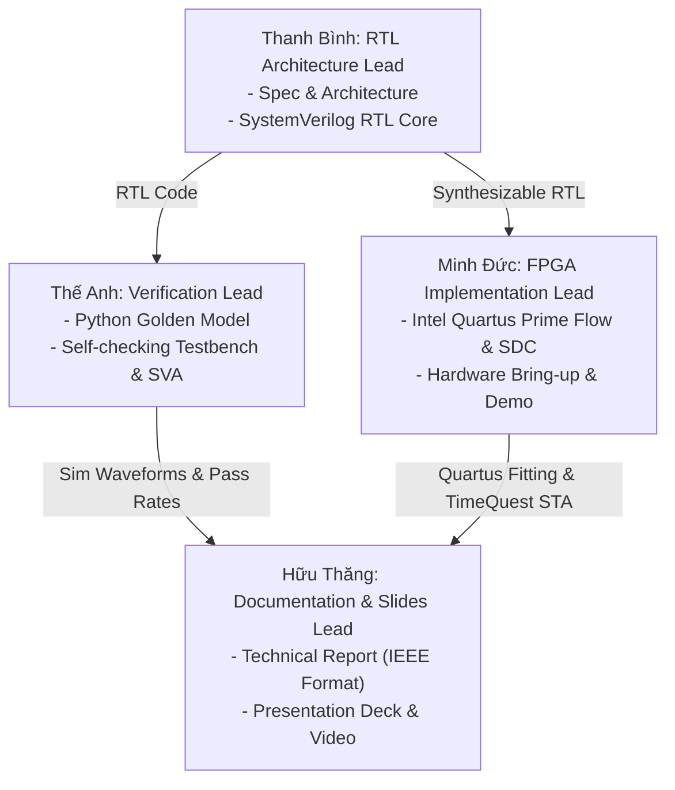

# EE5427: Pipelined 4x4 Matrix Multiply

This design multiplies two row-major 4x4 matrices of unsigned 4-bit elements.
Sixteen parallel MAC units compute all output elements. Each MAC computes a
four-element dot product with four parallel Vedic multipliers and a registered
balanced adder tree. The maximum result is 4 * 15 * 15 = 900, requiring 10 bits.

## 1. Datapath

Each MAC has five registered stages and accepts a new `START` every clock:

| Sampling edge | Stage | Operation |
| --- | --- | --- |
| N | Vedic quadrants | Register four 2x2 quadrant products for each of four element pairs |
| N+1 | Crosswise sums | Register crosswise sums and aligned diagonal products |
| N+2 | Products | Register all four completed 4x4 products |
| N+3 | Pair sums | Register two 9-bit sums in parallel |
| N+4 | Result | Register the 10-bit dot product and assert `DONE` |

`START` is an input-valid strobe. Consecutive high cycles request independent
operations. `DONE` is the corresponding output-valid signal and may remain high
for consecutive results. Bubbles propagate through the pipeline; C holds its
last result when DONE is low. Reset clears outputs and flushes in-flight work.
There is no sequential accumulation feedback or busy counter in the MAC.

All additions use reusable 4-bit CLA blocks. Block propagate/generate signals
feed direct look-ahead equations for every block carry, removing carry ripple
between blocks. Non-multiple-of-four widths are zero-padded internally.

The generic combinational Vedic multiplier uses explicit generated levels,
with no module instantiating itself, so Vivado hierarchy analysis is acyclic.
It remains available through
`Multiple_multiplier` and `MAC_MULTIPLIER`. The MAC datapath uses
`VEDIC4_PIPELINED`, splitting crosswise and final product additions into separate
clock stages. Its 2x2 base case uses two half-adders.

## 2. Matrix interface

| Signal | Direction | Meaning |
| --- | --- | --- |
| `clk`, `rst_n` | Input | Rising-edge clock, asynchronous active-low reset |
| `A[63:0]`, `B[63:0]` | Input | Sixteen row-major 4-bit elements, first element at [63:60] |
| `LOAD` | Input | Capture both input matrices |
| `START` | Input | Submit the currently loaded matrices to all MACs |
| `C[159:0]` | Output | All sixteen 10-bit results, row-major, first element at [159:150] |
| `DONE` | Output | All matrix results are valid together |

`SELECT` has been removed. Element i is `C[159-10*i -: 10]`. The output bus
updates atomically on edge N+4 for a START accepted on edge N. There is no
additional output-copy cycle or 16-cycle element readout.

LOAD and START are independent. If both are high on the same edge, START
submits the previously loaded matrices while LOAD captures the next pair.
After an initial LOAD, this supports one new matrix operation per clock.
To submit freshly loaded matrices, assert START on the following edge.

## 3. UART interface

Connect `MAC4x4_uart` to the matrix core's LOAD, START, A, B, C, and DONE ports.
The transport receives 16 bytes (A then B), starts computation, snapshots the
entire result matrix, and sends one continuous 32-byte 8N1 response. Each result
uses two bytes, high byte first. No selection commands or extra idle gaps occur
between response bytes. See [docs/UART.md](docs/UART.md) for the complete protocol.

The serial transport handles one transaction at a time. UART wire bandwidth
still limits host throughput: the response requires 320 bit periods. The matrix
core itself supports one result matrix per clock after pipeline fill.

## 4. Performance and implementation tradeoffs

- Core initiation interval: one clock, previously six.
- START-to-DONE latency: four clock intervals, spanning five registered stages.
- Multipliers: four per MAC, or 64 for the matrix core, previously 16 total.
- More pipeline registers and arithmetic hardware are required for parallelism.
- Achievable Fmax, area, and routing delay require synthesis and place-and-route
  on the selected FPGA. Functional simulation does not establish timing closure.

The historical course specification and image in `docs/` describe the earlier
sequential architecture; the tables above describe the current RTL.

## 5. Verification

With Icarus Verilog and `vvp` on PATH, run from the repository root:

```powershell
powershell -NoProfile -File tb/run_tests.ps1
```

The runner compiles packages first and stores artifacts in a temporary directory.
It runs seven self-checking testbenches: exhaustive small adders and combinational
multipliers, wider carry tests, exhaustive pipelined 4-bit multiplication,
full-rate MAC and matrix streams, and end-to-end UART transactions. Tests include
valid bubbles, maximum values, matrix ordering, reset with requests in flight,
framing recovery, uninterrupted UART byte timing, and response snapshot stability.
The board-level test also checks power-on reset and repeated UART requests.

### Nexys A7-100T implementation

The FPGA top is `top_fpga_wrapper`, with only three physical ports:
`CLK100MHZ`, `UART_RXD`, and `UART_TXD`. Buttons, switches, LEDs, and seven-segment
display ports are removed. Reset is generated internally for four clock cycles
after configuration. There is no external reset input; reconfigure the FPGA to
restart after a lost UART packet boundary. The host uses 9600 baud, 8N1, with
hardware flow control disabled.

`fpga/nexys_a7.xdc` assigns the clock and USB-UART pins, the 100 MHz clock,
I/O standards, and configuration voltage. Its UART timing exceptions cover only
the asynchronous input to the first RX synchronizer stage and the external TX
output; internal register timing remains checked.

Open `project_1.xpr` with `top_fpga_wrapper` selected as the synthesis top, or run:

```powershell
vivado -mode batch -source fpga/build_nexys_a7.tcl
```

To repair an existing GUI project that still selects `MAC4x4`, run this in its
Tcl console from the repository root before rebuilding:

```tcl
source fpga/repair_project.tcl
```

To repair and rebuild the saved project, including resetting failed runs:

```powershell
vivado -mode batch -source fpga/rebuild_project.tcl
```

When switching between batch and an already open GUI, reopen the saved project
before saving from the GUI so its older in-memory settings do not overwrite the
repaired top and source list. The project build writes its bitstream under
`project_1.runs/impl_1/`; the independent build below uses `build/nexys_a7/`.

The reproducible build runs synthesis, placement, routing, timing checks, and
bitstream generation. Outputs are `build/nexys_a7/top_fpga_wrapper.bit` and the
adjacent timing, utilization, and DRC reports. No board programming is performed.

## 6. Source layout

| Path | Purpose |
| --- | --- |
| `rtl/ADDER.sv` | Parameterized CLA-based adder and 4-bit CLA primitive |
| `rtl/MULTIPLIER.sv` | Parameterized combinational Vedic multiplier |
| `rtl/VEDIC4_PIPELINED.sv` | Three-stage 4-bit Vedic multiplier |
| `rtl/MAC.sv` | Four parallel products and registered adder tree |
| `rtl/MAC4x4.sv` | Sixteen MACs and full matrix result bus |
| `rtl/MAC4x4_uart.sv` | Matrix receive, compute control, and continuous response serializer |
| `rtl/top_fpga_wrapper.sv` | UART-only board integration and power-on reset |
| `fpga/` | Nexys A7 constraints and reproducible Vivado build |
| `rtl/uart/` | UART package, RX, clock enables, and standalone byte TX |
| `tb/` | Arithmetic, pipeline, matrix, and serial testbenches |
| `docs/UART.md` | UART packet and transaction contract |

---
## 7. Team Work Breakdown & Responsibilities (4 Members)

The project tasks are distributed across 4 team members: **Thanh Bình**, **Thế Anh**, **Minh Đức**, and **Hữu Thăng**:



### Assignment & Issues Matrix

| Member | Primary Role | Assigned Tasks / GitHub Issues | Key Deliverables |
| :--- | :--- | :--- | :--- |
| **Thanh Bình** | **RTL Architecture Lead** | • [Issue #3](https://github.com/ducnguyen-git/EE5427---4x4-Multiply-Accumulate/issues/3): Microarchitecture Spec & Interface Contract<br>• [Issue #2](https://github.com/ducnguyen-git/EE5427---4x4-Multiply-Accumulate/issues/2): SystemVerilog RTL Implementation (`mac_top`) | Architectural spec, mathematical sizing proof, synthesizable RTL (`mac_top.sv`, `shift_reg.sv`, `multiplier_4x4.sv`, `adder_10bit.sv`), clean linting. |
| **Thế Anh** | **Design Verification Lead** | • [Issue #4](https://github.com/ducnguyen-git/EE5427---4x4-Multiply-Accumulate/issues/4): Python Golden Model & Stimulus Suite<br>• [Issue #1](https://github.com/ducnguyen-git/EE5427---4x4-Multiply-Accumulate/issues/1): Self-Checking Testbench & Coverage Sign-off | Python reference model (`mac_ref_model.py`), corner-case vectors (`test_vectors.hex`), self-checking SystemVerilog testbench (`mac_top_tb.sv`), SVA assertions, waveform traces. |
| **Minh Đức** | **FPGA Implementation Lead** | • [Issue #5](https://github.com/ducnguyen-git/EE5427---4x4-Multiply-Accumulate/issues/5): Intel Quartus Prime Synthesis, Constraints (.sdc) & STA<br>• [Issue #6](https://github.com/ducnguyen-git/EE5427---4x4-Multiply-Accumulate/issues/6): Board Bring-Up, SOF Programming & Hardware Demo | Quartus Prime project, TimeQuest SDC constraints (`mac_de10_lite.sdc`), TimeQuest STA closure, FPGA board wrapper (`top_fpga_wrapper.sv`), SOF file, hardware demo. |
| **Hữu Thăng** | **Documentation & Presentation Lead** | • [Issue #7](https://github.com/ducnguyen-git/EE5427---4x4-Multiply-Accumulate/issues/7): Danh mục Yêu cầu BTL & Báo cáo Kỹ thuật (Trang 5-6)<br>• [Issue #8](https://github.com/ducnguyen-git/EE5427---4x4-Multiply-Accumulate/issues/8): Presentation Slides & Demo Walkthrough | Formal IEEE/course design report (PDF), presentation slide deck (`.pptx` / PDF), annotated waveform figures, video demo recording, defense Q&A preparation. |

---

## 8. Verification & Simulation Guide

See section 5 and run `tb/run_tests.ps1`. All seven tests, including the UART-only
board startup and matrix-transaction test, are included in the RTL regression.

---

## 9. Intel Quartus Prime FPGA Flow & Resource Utilization

### Target Device: Intel MAX 10 (`10M50DAF484C7G` / Terasic DE10-Lite)

### Quartus Prime Compilation Flow:
1. **Analysis & Synthesis**:
   ```bash
   quartus_map --read_settings_files=on --write_settings_files=off mac_project -c top_fpga_wrapper
   ```
2. **Fitter (Place & Route)**:
   ```bash
   quartus_fit --read_settings_files=off --write_settings_files=off mac_project -c top_fpga_wrapper
   ```
3. **Assembler (Generate `.sof`)**:
   ```bash
   quartus_asm --read_settings_files=off --write_settings_files=off mac_project -c top_fpga_wrapper
   ```
4. **TimeQuest Static Timing Analysis**:
   ```bash
   quartus_sta mac_project -c top_fpga_wrapper
   ```
5. **Program Board via USB-Blaster**:
   ```bash
   quartus_pgm -m jtag -c 1 -o "p;output_files/top_fpga_wrapper.sof"
   ```

### Resource utilization and timing

The previous sequential MAC estimates do not apply to the parallel matrix
architecture. Generate fresh synthesis, fitter, and timing reports for the
chosen target before quoting area or operating frequency.
