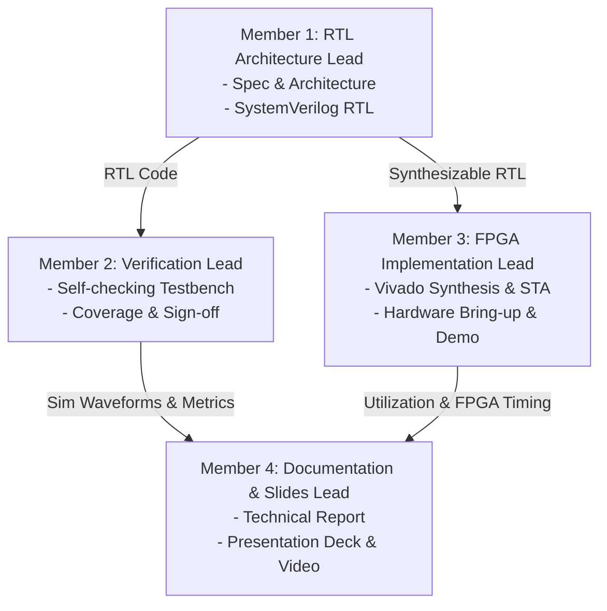

# EE5427: 4-element 4-bit Pipelined Multiply-Accumulate (MAC) Unit

[](https://en.wikipedia.org/wiki/SystemVerilog)
[](https://www.xilinx.com)
[](https://www.amd.com/en/products/software/adaptive-socs-and-fpgas/vivado.html)
[](LICENSE)

---

## 1. Project Overview & Motivation

In high-performance digital computing—specifically across **Digital Signal Processing (DSP)**, **Deep Learning inference engines (Systolic Arrays, TPU cores)**, and **Matrix-Vector Multiplications (MVM)**—the **Multiply-Accumulate (MAC)** unit is the core arithmetic workhorse.

This repository hosts the full RTL design, verification, and FPGA implementation for a **4-element 4-bit pipelined Multiply-Accumulate unit** developed for **EE5427**. Given two 16-bit input vectors $A$ and $B$, each packed with four unsigned 4-bit elements:

$$\mathbf{A} = \{A_3, A_2, A_1, A_0\}, \quad \mathbf{B} = \{B_3, B_2, B_1, B_0\}$$

The MAC unit sequentially processes the four element pairs and computes their scalar dot-product:

$$C = \sum_{i=0}^{3} A_i \times B_i = A_0 \cdot B_0 + A_1 \cdot B_1 + A_2 \cdot B_2 + A_3 \cdot B_3$$

---

## 2. Microarchitecture & Block Diagram

The datapath decouples the multiplication and accumulation stages using an intermediate pipeline register to maximize operating frequency ($F_{max}$) and prevent long combinational paths.


### Datapath Sub-modules

| Logic Block | Bitwidth / Type | Description & Functionality |
| :--- | :--- | :--- |
| **Input / Shift Registers** | 16-bit parallel load, 4-bit shift | Latches vectors $A[15:0]$ and $B[15:0]$ on `START = 1`. Sequentially shifts right by 4 bits each cycle to present pairs $(A_i, B_i)$ to the multiplier. |
| **Multiplier** | 4-bit $\times$ 4-bit $\to$ 8-bit combinational | Computes unsigned product $A_i \times B_i$. Maximum single product is $15 \times 15 = 225$. |
| **Product Pipeline Register** | 8-bit registered | Registers the multiplier output on the clock edge, establishing pipeline Stage 1 and breaking the critical path between multiplier and adder. |
| **Accumulator / Adder** | 10-bit adder ($10\text{b} + 10\text{b} \to 10\text{b}$) | Sums the zero-extended 8-bit registered product $\{2'b00, P_i\}$ with the accumulated sum feedback. |
| **Accumulator Pipeline Register** | 10-bit registered | Latches the accumulated sum, feeds back to Port B of the adder, and directly drives top-level output $C[9:0]$. Cleared to 0 at the start of calculation. |
| **Control Logic & Counter** | 3-bit sequencer FSM | Tracks the 4-phase calculation cycles, generates shift enables, controls accumulator clear/feedback, and asserts `DONE`. |
| **DONE Logic** | 1-bit status output | Asserted high when the accumulation of all 4 products has settled in the output register. |
| **Reset Logic** | Active-low asynchronous | Restores all datapath registers and FSM states to a clean initialized state. |

---

## 3. Mathematical Analysis & Bitwidth Proof

### 1. Element Range
Each element $A_i, B_i$ is an unsigned 4-bit integer:
$$0 \le A_i \le 2^4 - 1 = 15$$
$$0 \le B_i \le 2^4 - 1 = 15$$

### 2. Multiplier Bitwidth
The maximum product of a single element pair occurs when $A_i = 15$ and $B_i = 15$:
$$P_{max} = 15 \times 15 = 225$$
$$\lceil \log_2(225 + 1) \rceil = \lceil \log_2(226) \rceil = 8 \text{ bits}$$
Thus, an **8-bit bus** $P[7:0]$ ($[0, 255]$) provides sufficient range with zero overflow.

### 3. Accumulator Bitwidth
The maximum possible dot-product accumulated over 4 elements is:
$$C_{max} = \sum_{i=0}^3 P_{max} = 4 \times 225 = 900$$
To guarantee no overflow:
$$\lceil \log_2(900 + 1) \rceil = \lceil 9.815 \rceil = 10 \text{ bits}$$
With a **10-bit output bus** $C[9:0]$, the representable range is $[0, 1023]$, guaranteeing that **overflow is mathematically impossible** since $900 < 1023$.

---

## 4. Input / Output Interface Specifications

| Signal Name | Direction | Bitwidth | Active Level | Description |
| :--- | :---: | :---: | :---: | :--- |
| `clk` | Input | 1 bit | Rising Edge | System operating clock. |
| `rst_n` | Input | 1 bit | Low (`0`) | Asynchronous active-low global reset. Returns registers and FSM to initial state. |
| `START` | Input | 1 bit | High (`1`) | 1-clock-cycle pulse requesting the MAC unit to latch $A$ and $B$ and trigger a new computation. |
| `A` | Input | 16 bit | - | Packed input vector $A = \{A_3, A_2, A_1, A_0\}$. Each chunk is unsigned 4-bit. |
| `B` | Input | 16 bit | - | Packed input vector $B = \{B_3, B_2, B_1, B_0\}$. Each chunk is unsigned 4-bit. |
| `C` | Output | 10 bit | - | Final dot-product result: $\sum_{i=0}^3 A_i \times B_i$. Valid when `DONE = 1`. |
| `DONE` | Output | 1 bit | High (`1`) | Flags that the calculation is complete and output $C[9:0]$ holds a valid result. |

---

## 5. Timing Diagram & Cycle-by-Cycle Execution Trace

| Clock Cycle | FSM State / Counter | Shift Reg A Output | Shift Reg B Output | Multiplier Product $P$ | Pipeline Reg ($P_{reg}$) | Adder Output | Accumulator Reg ($C$) | `DONE` |
| :---: | :---: | :---: | :---: | :---: | :---: | :---: | :---: | :---: |
| **0** | `START = 1` | $A_0$ | $B_0$ | $A_0 \cdot B_0$ | `0` | `0` | `0` | `0` |
| **1** | `CALC (count=1)` | $A_1$ | $B_1$ | $A_1 \cdot B_1$ | $P_0$ | $P_0 + 0$ | `0` | `0` |
| **2** | `CALC (count=2)` | $A_2$ | $B_2$ | $A_2 \cdot B_2$ | $P_1$ | $P_1 + P_0$ | $P_0$ | `0` |
| **3** | `CALC (count=3)` | $A_3$ | $B_3$ | $A_3 \cdot B_3$ | $P_2$ | $P_2 + (P_0 + P_1)$ | $P_0 + P_1$ | `0` |
| **4** | `CALC (count=4)` | - | - | - | $P_3$ | $P_3 + \sum_{0}^2 P_i$ | $\sum_{0}^2 P_i$ | `0` |
| **5** | `FINISH (count=5)`| - | - | - | - | - | **$\sum_{i=0}^3 P_i$** | **`1`** |

- **Latency:** 5 clock cycles from the assertion of `START` to the assertion of `DONE`.
- **Throughput:** A new operation can be accepted every 6 clock cycles (or continuously pipelined with overlapping shift operations).

---

## 6. Project Directory Structure

```text
EE5427---4x4-Multiply-Accumulate/
├── README.md                      # Project documentation and specifications
├── .gitignore                     # Git ignore rules for EDA synthesis & sim junk
├── docs/                          # Design documents and schematics
│   ├── mac_block_diagram.jpg      # Microarchitecture block diagram
│   └── mac_block_specification.pdf# Course specification document
├── rtl/                           # Synthesizable SystemVerilog source code
│   ├── mac_top.sv                 # Top-level MAC module & sequencer
│   ├── shift_reg.sv               # 16-bit to 4-bit serialization shift register
│   ├── multiplier_4x4.sv          # 4-bit x 4-bit unsigned combinational multiplier
│   └── adder_10bit.sv             # 10-bit accumulator adder
├── tb/                            # Verification environment
│   ├── mac_top_tb.sv              # Self-checking SystemVerilog testbench
│   └── mac_ref_model.py           # Python golden model & vector generator
└── fpga/                          # FPGA implementation files
    ├── constraints/
    │   └── mac_basys3.xdc         # Xilinx Artix-7 pin & timing constraints
    └── top_fpga_wrapper.sv        # Board evaluation wrapper (Switches, LEDs, Buttons)
```

---

## 7. Team Work Breakdown & Responsibilities (4 Members)

To ensure smooth collaboration, accountability, and project success, the workload is distributed across 4 specialized roles:



### Role Breakdown

| Member | Primary Role | Assigned Tasks / GitHub Issues | Key Deliverables |
| :--- | :--- | :--- | :--- |
| **Member 1** | **RTL Architecture Lead** | • Issue #1: Microarchitecture & Interface Spec<br>• Issue #2: SystemVerilog RTL Design (`mac_top`) | Synthesizable RTL, clean linting, datapath pipelining. |
| **Member 2** | **Design Verification Lead** | • Issue #3: Self-Checking Testbench Environment<br>• Issue #4: Corner-Case Regression & Coverage Sign-off | Randomized TB, waveform dumps, 100% functional coverage. |
| **Member 3** | **FPGA Implementation Lead** | • Issue #5: Synthesis, Constraints & Static Timing (STA)<br>• Issue #6: Board Bring-Up & Hardware Demo Wrapper | Bitstream, resource utilization report, physical FPGA demo. |
| **Member 4** | **Documentation & Presentation Lead** | • Issue #7: Comprehensive Project Technical Report<br>• Issue #8: Presentation Slides & Demo Walkthrough | Formal project report (PDF), slide deck, demo recording. |

---

## 8. Verification & Simulation Guide

### Golden Reference Model
Generate random test vectors and cross-verify with the Python reference model:
```bash
python tb/mac_ref_model.py
```

### Running SystemVerilog Simulation
Using **Vivado xsim**:
```bash
xvlog -sv rtl/multiplier_4x4.sv rtl/adder_10bit.sv rtl/shift_reg.sv rtl/mac_top.sv tb/mac_top_tb.sv
xelab -top mac_top_tb -snapshot mac_sim
xsim mac_sim -R
```

Using **ModelSim / QuestaSim**:
```bash
vlib work
vlog -sv rtl/*.sv tb/*.sv
vsim -c -do "run -all; quit" mac_top_tb
```

---

## 9. FPGA Resource Utilization (Artix-7 xc7a35t)

| Resource | Estimated Utilization | Available on Basys 3 | Percentage |
| :--- | :---: | :---: | :---: |
| **LUTs (Logic)** | ~35 - 50 | 20,800 | < 0.5% |
| **Flip-Flops (FFs)** | ~45 - 60 | 41,600 | < 0.5% |
| **DSP48 Slices** | 0 (Implemented in LUTs) | 90 | 0% |
| **Target Clock** | 100 MHz ($T_{clk} = 10\text{ ns}$) | - | Slack $> 4\text{ ns}$ |
