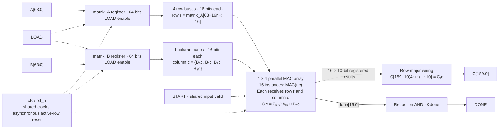

# MAC4x4 architecture

Based on `rtl/MAC4x4.sv` and `rtl/MAC.sv`. Only the matrix core is shown.

- Matrices contain sixteen unsigned 4-bit elements; element 0 is bits [63:60].
- Each MAC contains four parallel, three-stage `VEDIC4_PIPELINED` multipliers, two registered 9-bit pair sums, and a registered 10-bit final sum.
- START sampled at edge N produces C and DONE at edge N+4; initiation interval is one clock.
- LOAD and START on the same edge submit the previously stored matrices and capture the next matrices.
- C holds its last result when DONE is low. The output packing is wiring, with no extra output register or readout cycle.
