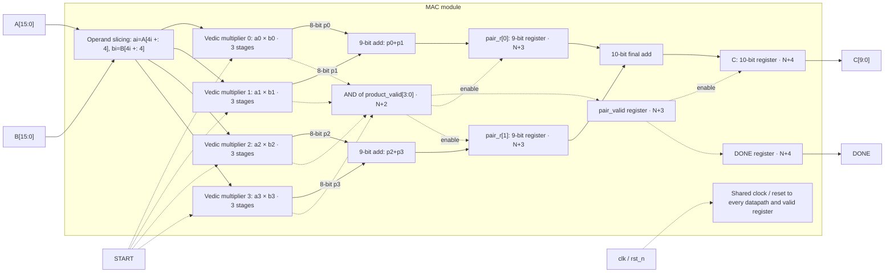

# Single MAC architecture

See the [SVG diagram](mac_architecture.svg). Based on `rtl/MAC.sv` and
`rtl/VEDIC4_PIPELINED.sv`.



## Datapath operation

The single MAC computes an unsigned four-element dot product:

```text
C = a0*b0 + a1*b1 + a2*b2 + a3*b3
```

In the matrix core, one MAC receives one row of matrix A and one column of
matrix B, producing their corresponding output element. All four products
are formed in parallel and combined through a balanced, registered adder
tree. Each request produces an independent result; the previous value of C
does not feed back into the arithmetic.

### Operand slicing

The 16-bit inputs A and B each contain four unsigned 4-bit operands. Static
wiring splits these buses into four matching multiplier lanes:

| Lane i | ai | bi | Product |
| --- | --- | --- | --- |
| 0 | A[3:0] | B[3:0] | product[0] = a0*b0 |
| 1 | A[7:4] | B[7:4] | product[1] = a1*b1 |
| 2 | A[11:8] | B[11:8] | product[2] = a2*b2 |
| 3 | A[15:12] | B[15:12] | product[3] = a3*b3 |

This slicing requires no arithmetic or storage. Unlike MAC4x4, the single MAC
has no LOAD input or separate input-matrix registers. When START is high at a
rising edge, the first multiplier stage captures partial products derived
directly from the current A and B inputs. Later changes to A/B do not affect
that accepted request.

### Parallel multiplication: stages 1–3

Each lane uses one `VEDIC4_PIPELINED` instance to multiply its two 4-bit
operands. Within a lane, each operand is split into high and low 2-bit halves:

```text
a = 4*aH + aL                 b = 4*bH + bL
q0 = aL*bL                   q1 = aH*bL
q2 = aL*bH                   q3 = aH*bH
a*b = 16*q3 + 4*(q1+q2) + q0
```

At edge N, stage 1 registers the four 4-bit quadrant products q0 through q3.
At N+1, stage 2 registers the 5-bit crosswise sum `q1+q2` and the 8-bit aligned
diagonal value `{q3,q0}`, which represents `16*q3+q0`. At N+2, stage 3 adds
the diagonal value to the crosswise sum shifted left by two bits, registering
the completed 8-bit product. All four lanes follow the same schedule, so the
four products for a request become available together.

### Pair addition: stage 4

Two combinational `Multiple_adder` instances sum adjacent products in parallel:

```text
pair_sum[0] = zero_extend(product[0]) + zero_extend(product[1])
pair_sum[1] = zero_extend(product[2]) + zero_extend(product[3])
```

Each product can reach 225. Adding two products can reach 450, so each input
is zero-extended from 8 to 9 bits before addition. At edge N+3, the two sums
are captured in `pair_r[0]` and `pair_r[1]` when all four product-valid signals
are high. The register boundary separates pair addition from final addition,
keeping the two adder levels in different clock stages.

### Final addition and output: stage 5

The final combinational `Multiple_adder` adds the two registered pair sums.
Both inputs are zero-extended from 9 to 10 bits:

```text
result = zero_extend(pair_r[0]) + zero_extend(pair_r[1])
```

At edge N+4, `pair_valid` enables the output register to capture result into
`C[9:0]`. The maximum result is `4*15*15 = 900`, which fits in 10 unsigned
bits. The datapath therefore preserves the exact result without truncation,
saturation, or rounding. If no valid result reaches this stage, C holds its
previous value.

## Valid signals, clock, and reset

START serves as input valid for all four multipliers. Each multiplier delays
this valid indication through its three stages and drives one bit of
`product_valid[3:0]`. The reduction `&product_valid` enables both pair-sum
registers and is captured into `pair_valid`. On the following edge,
`pair_valid` enables C and is captured into DONE. This control path keeps
each valid indication aligned with its arithmetic result.

DONE indicates that the complete C value is valid after the current edge.
It can remain high across consecutive results, so a consumer must accept
every high cycle rather than only the rising transition. A low START cycle
inserts a bubble; it does not stall requests already in flight.

All registers share the rising-edge clock `clk` and asynchronous active-low
reset `rst_n`. Asserting reset clears arithmetic registers, C, and all valid
registers, including DONE. It discards pending requests. START, clk, and
rst_n are external inputs, as shown outside the diagram's module boundary.

## Pipeline timing

For a request accepted with START high at edge N:

| Edge | Registered datapath state | Valid state for this request |
| --- | --- | --- |
| N | Four quadrant products in each multiplier | First multiplier valid stage |
| N+1 | Crosswise sums and aligned diagonals | Second multiplier valid stage |
| N+2 | Four completed 8-bit products | All product_valid bits high |
| N+3 | Two 9-bit pair sums | pair_valid high |
| N+4 | Final 10-bit C | DONE high |

The five registered stages span four clock intervals from START sampling to
the updated C/DONE outputs. The initiation interval is one clock: once the
pipeline fills, it can produce one dot product per clock. These timing
relationships assume reset remains inactive during the request.

For example, operands packed as `A=16'h4321` and `B=16'h8765` produce
`1*5 + 2*6 + 3*7 + 4*8 = 70`. If START samples these inputs at N, C becomes
`10'd70` and DONE becomes high after N+4, following register propagation.
